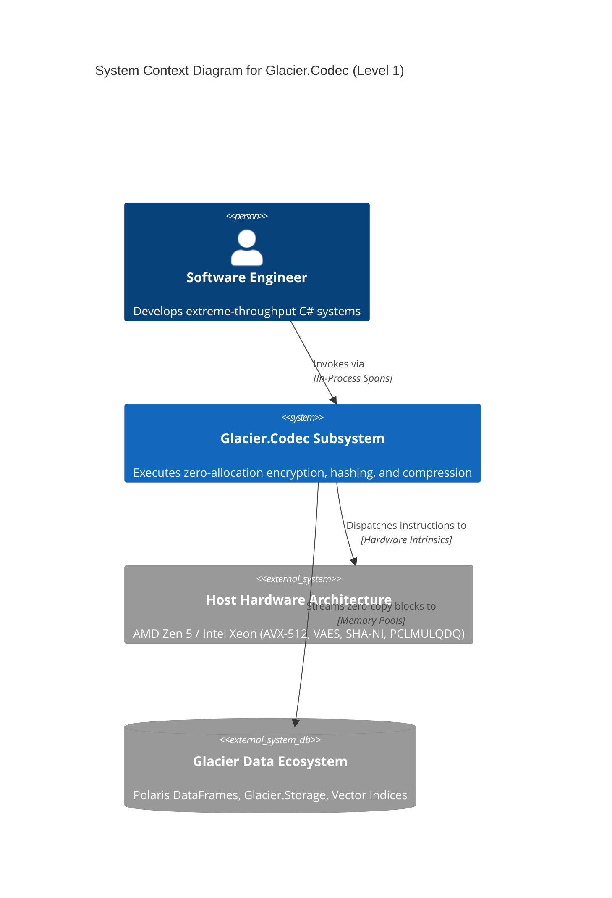
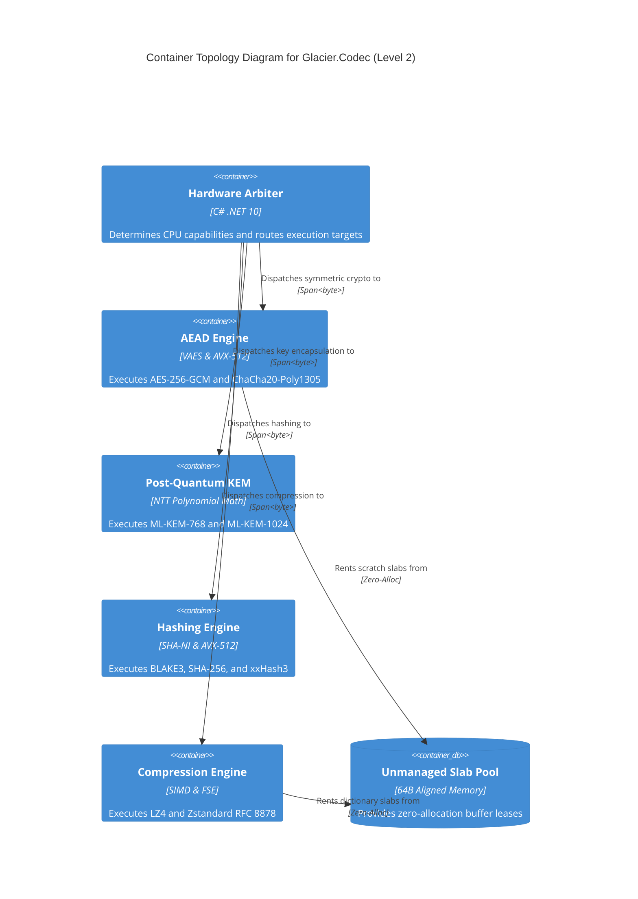
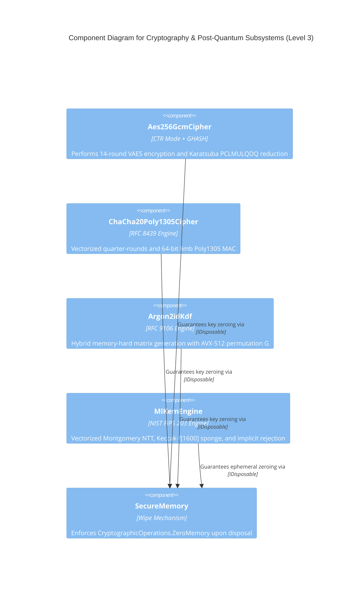
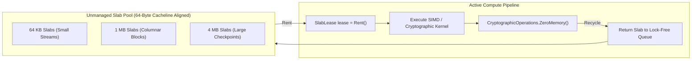
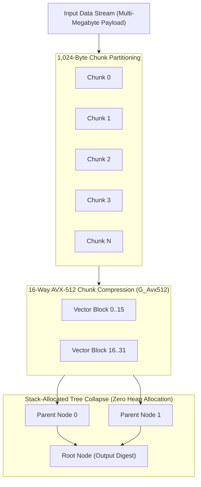

<!--
================================================================================
GLACIER HYBRID DOCUMENTATION STANDARD — DECLARATIVE DIAGRAM SUITE
DATA MODULE CODE: DMC-GLACIER-CODEC-A-00-00-00-00A-040C-A
SPECIFICATION CONFORMANCE: C4 Model / Mermaid / ASD-STE100 (Issue 9) / S1000D ICN
TARGET RUNTIME: C# .NET 10 / High-Performance Hardware Pipelines / Markdown Render
================================================================================
-->

# Declarative Diagram Suite: Glacier.Codec

```
 ██████╗ ██╗ █████╗  ██████╗ ██████╗  █████╗ ███╗   ███╗███████╗
 ██╔══██╗██║██╔══██╗██╔════╝ ██╔══██╗██╔══██╗████╗ ████║██╔════╝
 ██║  ██║██║███████║██║  ███╗██████╔╝███████║██╔████╔██║███████╗
 ██║  ██║██║██╔══██║██║   ██║██╔══██╗██╔══██║██║╚██╔╝██║╚════██║
 ██████╔╝██║██║  ██║╚██████╔╝██║  ██║██║  ██║██║ ╚═╝ ██║███████║
 ╚═════╝ ╚═╝╚═╝  ╚═╝ ╚═════╝ ╚═╝  ╚═╝╚═╝  ╚═╝╚═╝     ╚═╝╚══════╝
            REUSABLE ARCHITECTURAL & PIPELINE DIAGRAM SUITE
```

---

## Document Identification

| Specification Attribute | Value |
| :--- | :--- |
| **Data Module Code (DMC)** | `DMC-GLACIER-CODEC-A-00-00-00-00A-040C-A` |
| **System Identification** | Glacier Ecosystem — Glacier.Codec Visual Specifications |
| **Information Code** | `040` (Architectural & Conceptual Diagrams) |
| **Diagram Syntax** | Native Declarative Mermaid (Markdown-Embedded) |
| **Linguistic Standard** | ASD-STE100 Issue 9 Compliant |
| **Target Viewers** | GitHub Markdown, VS Code, Browser Portals, Static Site Generators |

---

## Table of Diagrams

1. [Diagram 1: System Context (C4 Level 1)](#diagram-1-system-context-c4-level-1)
2. [Diagram 2: Container Topology (C4 Level 2)](#diagram-2-container-topology-c4-level-2)
3. [Diagram 3: Component Decomposition (C4 Level 3)](#diagram-3-component-decomposition-c4-level-3)
4. [Diagram 4: Memory Layout and Buffer Lifecycle](#diagram-4-memory-layout-and-buffer-lifecycle)
5. [Diagram 5: BLAKE3 Multi-Threaded Tree Reduction Pipeline](#diagram-5-blake3-multi-threaded-tree-reduction-pipeline)

---

## Diagram 1: System Context (C4 Level 1)

### Information Control Number: `ICN-GLACIER-CODEC-C4L1-0001-A`



> **Metaphor:** The airport security and baggage sorting facility that inspects, seals, and compacts cargo containers before they load onto transport planes.  
> **Citation:** NIST SP 800-38D (Recommendation for Block Cipher Modes of Operation: Galois/Counter Mode).

---

## Diagram 2: Container Topology (C4 Level 2)

### Information Control Number: `ICN-GLACIER-CODEC-C4L2-0002-A`



---

## Diagram 3: Component Decomposition (C4 Level 3)

### Information Control Number: `ICN-GLACIER-CODEC-C4L3-0003-A`



---

## Diagram 4: Memory Layout and Buffer Lifecycle

### Information Control Number: `ICN-GLACIER-CODEC-MEM-0004-A`



> **Metaphor:** High-speed surgical trays that are checked out of clean storage, used during operation, sterilized immediately, and returned for the next patient.  
> **Citation:** Drepper, U. (2007). *What Every Programmer Should Know About Memory*. Red Hat Inc.

---

## Diagram 5: BLAKE3 Multi-Threaded Tree Reduction Pipeline

### Information Control Number: `ICN-GLACIER-CODEC-BLAKE3-0005-A`



> **Citation:** O'Connor, J., Aumasson, J.P., Neves, S., & Wilcox-O'Hearn, Z. (2020). *BLAKE3: one function, fast everywhere*. GitHub repository.
