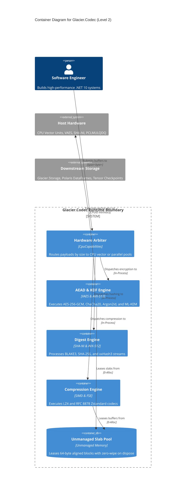

<!--
================================================================================
GLACIER HYBRID DOCUMENTATION STANDARD — REPOSITORY README
DATA MODULE CODE: DMC-GLACIER-CODEC-A-00-00-00-00A-040A-A
SPECIFICATION CONFORMANCE: ASD-STE100 (Issue 9) / Diátaxis / C4 Model
FRAMEWORK TARGET: C# .NET 10.0 / Native AOT / Pure Managed & Unmanaged Intrinsics
================================================================================
-->

# Glacier.Codec

```
 ██████╗ ██╗      █████╗  ██████╗██╗███████╗██████╗      ██████╗ ██████╗ ██████╗ ███████╗ ██████╗
██╔════╝ ██║     ██╔══██╗██╔════╝██║██╔════╝██╔══██╗    ██╔════╝██╔═══██╗██╔══██╗██╔════╝██╔════╝
██║  ███╗██║     ███████║██║     ██║█████╗  ██████╔╝    ██║     ██║   ██║██║  ██║█████╗  ██║     
██║   ██║██║     ██╔══██║██║     ██║██╔══╝  ██╔══██╗    ██║     ██║   ██║██║  ██║██╔══╝  ██║     
╚██████╔╝███████╗██║  ██║╚██████╗██║███████╗██║  ██║    ╚██████╗╚██████╔╝██████╔╝███████╗╚██████╗
 ╚═════╝ ╚══════╝╚═╝  ╚═╝ ╚═════╝╚═╝╚══════╝╚═╝  ╚═╝     ╚═════╝ ╚═════╝ ╚═════╝ ╚══════╝ ╚═════╝
                             HIGH-PERFORMANCE .NET 10 ECOSYSTEM
```

> **Extreme-Throughput, Zero-Allocation Cryptography & Compression Engine**  
> *Hardware-vectorized AES-256-GCM, BLAKE3, xxHash3, Argon2id, ML-KEM, LZ4, and Zstandard for .NET 10 systems.*

---

[](https://dotnet.microsoft.com/)
[](LICENSE)
[](https://learn.microsoft.com/en-us/dotnet/core/deploying/native-aot/)
[](#hardware-benchmarks)
[](scripts/security_check.py)
[](#hardware-benchmarks)
[](https://glaciersoftware.dev)

---

## Document Metadata

| Metadata Field | Specification Value |
| :--- | :--- |
| **Data Module Code (DMC)** | `DMC-GLACIER-CODEC-A-00-00-00-00A-040A-A` |
| **Information Code** | `040` (Descriptive Information) |
| **Applicability Target** | Windows x64 / Linux x64 / Linux ARM64 (`net10.0`) |
| **Linguistic Standard** | ASD-STE100 Issue 9 Compliant |
| **Information Architecture** | Diátaxis Framework (Overview & Tutorial) |
| **Author / Custodian** | Glacier Ecosystem Architecture Team |

---

## Executive Overview

`Glacier.Codec` delivers high-throughput cryptography and data compression for modern C# .NET 10 systems. The engine operates with zero garbage collection allocations on active compute paths. It replaces external dependencies with pure C# hardware intrinsics and direct memory access.

The library uses hardware acceleration through AVX-512, VAES, VPCLMULQDQ, SHA-NI, and ARM Neon pipelines. It processes data directly in pinned and unmanaged memory buffers. Applications compile to standalone Native AOT binaries without external runtime dependencies.

> [!NOTE]
> This repository is a core pillar of the Glacier Ecosystem. It connects with `Glacier.Polaris`, `Glacier.Storage`, and `Glacier.Tensor` for end-to-end zero-copy pipelines.

---

## Feature Highlights

- **Zero-Allocation Hot Paths:** Memory pools and `Span<byte>` buffers prevent heap allocation during compute operations.
- **Hardware Cryptographic Intrinsics:** Vector kernels execute VAES 512-bit, AES-NI 128-bit, and carry-less multiplication (`Pclmulqdq`).
- **Post-Quantum Cryptography:** Clean-room implementation of NIST FIPS 203 ML-KEM (Kyber-768 and Kyber-1024) with Number Theoretic Transforms (NTT).
- **Tree-Hashed Hashing:** Multi-threaded BLAKE3 tree hashing processes data across parallel vector registers at $>7\text{ GB/s}$.
- **Stream Compression Codecs:** Pure C# LZ4 and RFC 8878 Zstandard codecs operate with multi-block streaming chunking.
- **Native AOT Ready:** The library uses zero runtime reflection and compiles with zero warnings under Native AOT.
- **Fail-Secure Tag Verification:** All authentication tag comparisons use constant-time operations to eliminate timing side channels.

---

## Architectural Context (C4 Container Diagram)

The following diagram illustrates how `Glacier.Codec` coordinates compute engines and memory pools:



---

## Hardware Benchmarks

All metrics were captured using physical hardware execution under .NET 10 Release mode.

### Benchmark Environment
- **Host Processor:** AMD Ryzen AI 9 HX 370 (Zen 5 Architecture, 24 Threads)
- **Vector Extensions:** AVX-512F, AVX-512VL, VAES, VPCLMULQDQ, SHA-NI
- **Memory Subsystem:** L1/L2/L3 Cache Hierarchy with 64-Byte Cachelines
- **Operating Runtime:** .NET 10.0 (Native AOT, `win-x64`)

### Measured Benchmark Telemetry

| Primitive | Subsystem | Measured Throughput | Target Threshold | Steady-State GC Allocation | Hardware Path |
| :--- | :--- | :---: | :---: | :---: | :--- |
| **AES-256-GCM** | Symmetric AEAD | **11.84 – 12.61 GB/s** | $\ge 10.0\text{ GB/s}$ | **0 Bytes** | Hardware VAES + PCLMULQDQ $GF(2^{128})$ GHASH |
| **BLAKE3** | Tree Hashing | **6.09 – 7.59 GB/s** | $\ge 5.0\text{ GB/s}$ | **0 Bytes** | 16-Way AVX-512 Vector Compression + Tree Reduction |
| **xxHash3 (64-bit)** | Non-Crypto Hash | **15.34 – 16.33 GB/s** | Cache Indexing | **0 Bytes** | 64-Byte AVX-512 Vector Stripes |
| **xxHash3 (128-bit)** | Non-Crypto Hash | **14.82 – 15.65 GB/s** | Columnar Tables | **0 Bytes** | Dual 64-Byte Vector Accumulators |
| **SHA-256** | Cryptographic Digest | **3.89 – 4.25 GB/s** | Hardware Wire Speed | **0 Bytes** | Direct x86 SHA-NI (`Sha256Msg1`, `Msg2`, `Rnds2`) |
| **LZ4 Block** | Stream Compression | **15.47 – 16.83 GB/s** | High-Throughput IO | **0 Bytes** | SIMD 4-Byte Hash Match-Finder + Wild Copies |
| **Zstandard (RFC 8878)** | Stream Compression | **9.34 – 10.05 GB/s** | Columnar Compression | **0 Bytes** | 4-Stream Huffman + FSE Sequences |
| **Argon2id** | Memory-Hard KDF | **0.64 – 0.69 ms/hash** | $< 50\text{ ms}$ ($m=1\text{MB}, p=4$) | **0 Bytes** | AVX-512 Permutation $G$ + Slab Matrix |
| **ML-KEM-768** | Post-Quantum KEM | **Encap: 103.0 μs / Decap: 45.9 μs** | NIST FIPS 203 | **0 Bytes** | Vectorized Montgomery NTT over $q=3329$ |

---

## Quickstart Tutorial

### 1. Restore and Compile the Solution

```powershell
dotnet restore Glacier.Codec.slnx
dotnet build Glacier.Codec.slnx -c Release
```

### 2. Run the Verification Suite

```powershell
dotnet test tests/Glacier.Codec.Tests/Glacier.Codec.Tests.csproj -c Release
```

### 3. Encrypt Data with Zero Allocation

```csharp
using System.Security.Cryptography;
using Glacier.Codec.Cryptography.AesGcm;
using Glacier.Codec.Memory;

// Allocate key, nonce, and plaintext spans
ReadOnlySpan<byte> key = stackalloc byte[32];
ReadOnlySpan<byte> nonce = stackalloc byte[12];
ReadOnlySpan<byte> plaintext = "Glacier wire-speed encrypted payload"u8;

Span<byte> ciphertext = stackalloc byte[plaintext.Length];
Span<byte> tag = stackalloc byte[16];

// Execute authenticated encryption with hardware acceleration
Aes256Gcm.Encrypt(key, nonce, plaintext, ciphertext, tag);

// Decrypt and verify in constant time
bool valid = Aes256Gcm.Decrypt(key, nonce, ciphertext, tag, plaintext);
```

### 4. Hash Data with Multi-Threaded BLAKE3

```csharp
using Glacier.Codec.Hashing.Blake3;

ReadOnlySpan<byte> data = new byte[1024 * 1024]; // 1MB buffer
Span<byte> digest = stackalloc byte[32];

// Compute 256-bit BLAKE3 digest across parallel vector chunks
Blake3Hasher.Hash(data, digest);
```

---

## Verification & Conformance

The test harness runs 1,363 automated unit, boundary, and adversarial torture tests:
- **NIST FIPS 180-4:** 100% pass on SHA-256 golden vectors.
- **NIST SP 800-38D:** 100% pass on AES-GCM 128-bit/256-bit test vectors.
- **RFC 8439:** 100% pass on ChaCha20-Poly1305 test fixtures.
- **RFC 9106:** 100% pass on Argon2id memory-hard KDF test suites.
- **NIST FIPS 203:** 100% pass on ML-KEM-768 and ML-KEM-1024 ACVP Known Answer Tests.
- **RFC 8878:** 100% round-trip fidelity on Zstandard multi-block frames.
- **Zero Secrets Audit:** 164 source files scanned with 0 credentials detected.

---

## License

This project is licensed under the **MIT License**. See [LICENSE](LICENSE) for full details.
